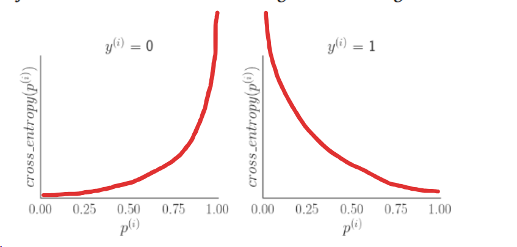

# Guia 11

## Ejercicio 1

### a

$y^(i)$ es la etiqueta real y $p^{i}$ es la probabilidad predicha por el modelo

### b



### c

Si el costo esta cerca de 0, se está asignando una probabilidad alta a la etiqueta positiva cuando la etiqueta real es efectivamente positiva. El costo se acerca a infinito cuando la etiqueta predicha difiere de la real (se predice 1 con alta prob cuando la real es 0 o viceversa).

### d

Es el promedio de las perdidas (Binary Cross-Entropy) de cada instancia.

$$J_{X, y}(w) = -\frac{1}{n} \sum_{i=1}^{n} \left[ y^{(i)} \ln(p^{(i)}) + (1 - y^{(i)}) \ln(1 - p^{(i)}) \right]$$   donde $p^{(i)} = \sigma(w^T x^{(i)}) = \frac{1}{1 + e^{-w^T x^{(i)}}}$

## Ejercicio 2

$$J_{\text{reg}}(w) = J(w) + \lambda \sum_{j=1}^{p} w_j^2$$

Si $\lambda$ tiende a infinito, cualquier valor de $w_j \neq 0$ ($j \ge 1$) generaría un costo infinito. Por lo tanto el valor esperado de la predicción sería el valor de $w_0$, el único peso que no se regulariza.

Luego el entrenamiento seteará el valor de w_0 para aquel que minimice la binary cross entropy promedio, que se minimiza con $p=\frac{n_1}{n}$, siendo $n_1$ la cantidad de instancias positivas y $n$ la cantidad de instancias totales.


<details open>
<summary>Desarrollo por gemini</summary>

Cuando $\lambda \to \infty$ en la regularización $L_2$ sin penalizar el sesgo, todos los pesos de las características se anulan ($w_1 = \dots = w_p = 0$).

Por lo tanto, para cualquier instancia $x^{(i)}$, la entrada neta a la sigmoide es constante e igual a $w_0$:

$$z^{(i)} = w_0$$


Esto hace que la probabilidad predicha para toda instancia sea un único valor constante $p$:

$$p^{(i)} = \sigma(w_0) = \frac{1}{1 + e^{-w_0}} \equiv p \quad \forall i \in \{1, \dots, n\}$$


#### Función de costo a minimizar

La función de Entropía Cruzada Binaria promedio para las $n$ instancias es:

$$J(p) = -\frac{1}{n} \sum_{i=1}^{n} \left[ y^{(i)} \ln(p) + (1 - y^{(i)}) \ln(1 - p) \right]$$


Dado que $p$ es constante para todas las instancias, podemos extraer $\ln(p)$ y $\ln(1-p)$ como factores comunes fuera de la sumatoria:

$$J(p) = -\frac{1}{n} \left[ \ln(p) \sum_{i=1}^{n} y^{(i)} + \ln(1 - p) \sum_{i=1}^{n} (1 - y^{(i)}) \right]$$


Definamos las cantidades de instancias según su clase real:

* $\sum_{i=1}^{n} y^{(i)} = n_1$ (cantidad total de instancias positivas, donde $y^{(i)} = 1$).


* $\sum_{i=1}^{n} (1 - y^{(i)}) = n - n_1 = n_0$ (cantidad total de instancias negativas, donde $y^{(i)} = 0$).


Reemplazando en la ecuación:

$$J(p) = -\frac{1}{n} \left[ n_1 \ln(p) + n_0 \ln(1 - p) \right]$$

#### Derivada respecto a $p$

Para encontrar el valor óptimo de $p$, derivamos $J(p)$ respecto a $p$ e igualamos a $0$:

$$\frac{d J(p)}{d p} = -\frac{1}{n} \left[ \frac{n_1}{p} - \frac{n_0}{1 - p} \right] = 0$$


Multiplicando por $-n$ a ambos lados:

$$\frac{n_1}{p} - \frac{n_0}{1 - p} = 0$$


$$\frac{n_1}{p} = \frac{n_0}{1 - p}$$


#### Despeje de la probabilidad óptima $p^*$

Multiplicamos cruzado:

$$n_1 (1 - p) = n_0 p$$

$$n_1 - n_1 p = n_0 p$$

$$n_1 = (n_1 + n_0) p$$

Como el total de instancias es $n_1 + n_0 = n$:

$$n_1 = n \cdot p \implies p^* = \frac{n_1}{n}$$

#### Determinación del valor óptimo de $w_0^*$

Sabiendo que $p^* = \sigma(w_0^*) = \frac{1}{1 + e^{-w_0^*}}$:

$$1 + e^{-w_0^*} = \frac{1}{p^*}$$


$$e^{-w_0^*} = \frac{1 - p^*}{p^*}$$


Invertimos la fracción cambiando el signo del exponente:

$$e^{w_0^*} = \frac{p^*}{1 - p^*}$$

Aplicando logaritmo natural a ambos lados:

$$w_0^* = \ln\left(\frac{p^*}{1 - p^*}\right) = \ln\left(\frac{n_1 / n}{n_0 / n}\right) = \ln\left(\frac{n_1}{n_0}\right)$$

El sesgo óptimo $w_0^*$ converge al logit (*log-odds*) de la proporción de clases del dataset de entrenamiento, produciendo una predicción de probabilidad constante igual a la frecuencia empírica de la clase positiva: $p^* = \frac{n_1}{n}$.

</details>

## Ejercicio 3

### 1

Podemos inferir el valor de $w_0$ cuando $x_1 = 0$.


## Ejercicio 4

### 1. Pseudocódigo de Descenso por el Gradiente para Regresión Logística

```python
def descenso_gradiente_logistica(X, y, alpha, n_iterations, tol):
    """
    Argumentos:
    - X (np.ndarray de float): Matriz de diseño de dimensión (n, p+1), 
      incluye columna de 1s para el sesgo (bias).
    - y (np.ndarray de int/float): Vector de etiquetas binarias {0, 1} de longitud n.
    - alpha (float): Tasa de aprendizaje (learning rate), e.g. 0.01.
    - n_iterations (int): Número máximo de iteraciones permitidas.
    - tol (float): Tolerancia para convergencia (criterio de parada sobre la norma del gradiente).
    """
    n, d = X.shape
    w = np.zeros(d)  # Inicialización de parámetros
    
    for s in range(n_iterations):
        # 1. Pasada Forward: predicción de probabilidades
        z = X @ w
        p = 1 / (1 + np.exp(-z))  # sigmoide
        
        # 2. Cálculo del gradiente
        grad = (1 / n) * (X.T @ (p - y))
        
        # 3. Criterio de parada temprana
        if np.linalg.norm(grad) < tol:
            break
            
        # 4. Actualización de parámetros
        w = w - alpha * grad
        
    return w

```

### 2. Cómo se obtiene el gradiente

Se aplica la regla de la cadena derivando la función de pérdida de entropía cruzada $J(w)$ con respecto a cada peso $w_j$:


$$\frac{\partial J}{\partial w_j} = \frac{1}{n} \sum_{i=1}^n \frac{\partial J^{(i)}}{\partial p^{(i)}} \cdot \frac{\partial p^{(i)}}{\partial z^{(i)}} \cdot \frac{\partial z^{(i)}}{\partial w_j}$$


Como demostramos en la diapositiva 40:

* $\frac{\partial J^{(i)}}{\partial p^{(i)}} = \frac{p^{(i)} - y^{(i)}}{p^{(i)}(1 - p^{(i)})}$


* $\frac{\partial p^{(i)}}{\partial z^{(i)}} = p^{(i)}(1 - p^{(i)})$


* $\frac{\partial z^{(i)}}{\partial w_j} = x_j^{(i)}$


El denominador de la primera derivada se cancela algebraicamente con la derivada de la sigmoide, resultando en:


$$\nabla_w J(w) = \frac{1}{n} X^T (p - y) = \frac{1}{n} \sum_{i=1}^n (p^{(i)} - y^{(i)}) x^{(i)}$$


### 3. Pseudocódigo de Mini-batch Gradient Descent

```python
def mini_batch_gradient_descent(X, y, alpha, batch_size, epochs):
    n, d = X.shape
    w = np.zeros(d)
    
    for epoch in range(epochs):
        # Barajar aleatoriamente los datos al inicio de cada época
        indices = np.random.permutation(n)
        X_shuffled = X[indices]
        y_shuffled = y[indices]
        
        for start_idx in range(0, n, batch_size):
            end_idx = min(start_idx + batch_size, n)
            X_batch = X_shuffled[start_idx:end_idx]
            y_batch = y_shuffled[start_idx:end_idx]
            b_size = len(y_batch)
            
            # Forward y backward sobre el lote
            z_batch = X_batch @ w
            p_batch = 1 / (1 + np.exp(-z_batch))
            grad = (1 / b_size) * (X_batch.T @ (p_batch - y_batch))
            
            # Actualización
            w = w - alpha * grad
            
    return w

```
