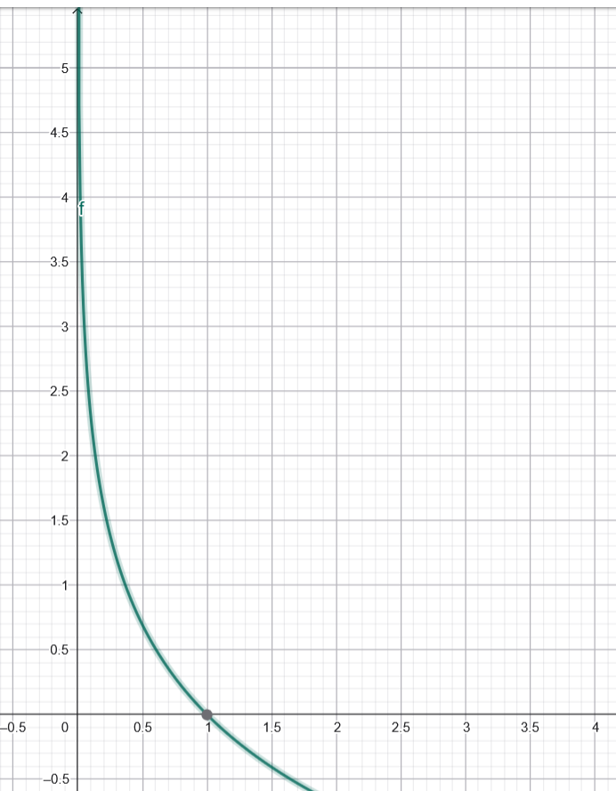

# Guia 12

## Ejercicio 1

### 1

Verdadero

### 2

Verdadero

### 3

Verdadero.

Para el caso de una única red, la matriz de pesos $W$ tendrá $p$ columnas (1 por atributo) y $q$ filas (1 por target). Las predicciones de cada target corresponde a:

$$\hat{y}_k = \sum_{j=0}^{p} w_{jk} x_j = w_k^T x \quad \text{para cada salida } k \in \{1, \dots, q\}$$

Cada fila de pesos corresponde a un único target. Y como no hay capas intermedias, los pesos entre targets no se relacionan.
Luego es equivalente a haber entrenado $q$ regresores lineales simples.

### 4

Falso. Siguiendo la idea anterior, la capa oculta relaciona los pesos. Luego al entrenar, se busca optimizar el error conjunto de las q salidas a la vez. Por el contrario, $q$ redes independientes especializan sus capas ocultas únicamente en su salida particular, aprendiendo pesos internos distintos.

## Ejercicio 2

Se tiene 2 entradas $X_1$ y $X_2$ binarias. Y una salida $Y$ binaria.

Para el caso del AND queremos modelar un perceptrón simple que cumpla la siguiente tabla:

| X_1 | X_2 | Y |
|-----|-----|---|
| 0   | 0   | 0 |
| 0   | 1   | 0 |
| 1   | 0   | 0 |
| 1   | 1   | 1 |

$Y = ReLU(-1 + X_1 * 1 + X_2 * 1)$

Par el caso del OR:

| X_1 | X_2 | Y |
|-----|-----|---|
| 0   | 0   | 0 |
| 0   | 1   | 1 |
| 1   | 0   | 1 |
| 1   | 1   | 1 |


$Y = g(-0.5 + X_1 * 1 + X_2 * 1)$

con g(x) = 0 si x <= 0 o g(x) = 1 si x > 0.

NOR:

| X_1 | X_2 | Y |
|-----|-----|---|
| 0   | 0   | 1 |
| 0   | 1   | 0 |
| 1   | 0   | 0 |
| 1   | 1   | 0 |

$Y = g(1 + X_1 * (-1) + X_2 * (-1))$

con g(x) = 0 si x <= 0 o g(x) = 1 si x > 0.

NAND:

| X_1 | X_2 | Y |
|-----|-----|---|
| 0   | 0   | 1 |
| 0   | 1   | 1 |
| 1   | 0   | 1 |
| 1   | 1   | 0 |

$Y = g(2 + X_1 * (-1) + X_2 * (-1))$

con g(x) = 0 si x <= 0 o g(x) = 1 si x > 0.

El XOR no es separable linealmente. Un perceptrón simple solo tiene la capacidad de establecer una frontera lineal. La función de activación solo aporta no linealidad a la salida, pero no a la frontera. Se necesita al menos 2 perceptrones simples:

XOR:

| X_1 | X_2 | Y |
|-----|-----|---|
| 0   | 0   | 0 |
| 0   | 1   | 1 |
| 1   | 0   | 1 |
| 1   | 1   | 0 |

(sacado del DL goodfellow cap 6)
$Y = w^T max\{0, W^Tx + c\} + b$
$W^T = \begin{bmatrix} 1 \\\ -2 \end{bmatrix}$

$c = \begin{bmatrix} 0 \\\ -1 \end{bmatrix}$

$W = \begin{bmatrix} 1 \ 1 \\\ 1 \ 1 \end{bmatrix}$

$b = 0$


## Ejercicio 3

La idea es que al tener activaciones lineales, todas las operaciones matriciales de todas las capas menos la ultima se puede reducir a una sola matriz. Finalmente, con la última activación sigmoidea, se tiene la regresión logística.

No tiene sentido usar muchas capas.

<details open>
<summary>Desarrollo por gemini</summary>
Toda función lineal general $g_l(z)$ se expresa como un escalamiento y un desplazamiento (o transformación afín coordenada a coordenada):

$$g_l(z) = c_l z + d_l \quad (c_l, d_l \in \mathbb{R}, \ c_l \neq 0)$$

O en su versión multivariable más general, $g_l(z) = C^{[l]} z + d^{[l]}$, donde $C^{[l]}$ es una matriz de transformación lineal.

#### Demostración general paso a paso

Consideremos una red de $L$ capas donde cada capa $l \in \{1, \dots, L-1\}$ tiene una transformación afín en sus pesos más una función de activación lineal $g_l$:

1. **Capa 1:**
* Preactivación: $z^{[1]} = W^{[1]} x + b^{[1]}$

* Activación lineal:

$$a^{[1]} = g_1(z^{[1]}) = C^{[1]} (W^{[1]} x + b^{[1]}) + d^{[1]} = (C^{[1]} W^{[1]}) x + (C^{[1]} b^{[1]} + d^{[1]})$$

* Definiendo $\tilde{W}^{[1]} = C^{[1]} W^{[1]}$ y $\tilde{b}^{[1]} = C^{[1]} b^{[1]} + d^{[1]}$, la activación es afín:

$$a^{[1]} = \tilde{W}^{[1]} x + \tilde{b}^{[1]}$$

2. **Capa $l$ (inducción hasta $L-1$):**
* Supongamos que $a^{[l-1]} = \tilde{W}^{[l-1]} x + \tilde{b}^{[l-1]}$.

* La capa $l$ calcula:

$$z^{[l]} = W^{[l]} a^{[l-1]} + b^{[l]} = W^{[l]} (\tilde{W}^{[l-1]} x + \tilde{b}^{[l-1]}) + b^{[l]} = (W^{[l]} \tilde{W}^{[l-1]}) x + (W^{[l]} \tilde{b}^{[l-1]} + b^{[l]})$$

* Al aplicar la activación lineal $g_l(z^{[l]}) = C^{[l]} z^{[l]} + d^{[l]}$:

$$a^{[l]} = C^{[l]} \left[ (W^{[l]} \tilde{W}^{[l-1]}) x + (W^{[l]} \tilde{b}^{[l-1]} + b^{[l]}) \right] + d^{[l]}$$

$$a^{[l]} = (C^{[l]} W^{[l]} \tilde{W}^{[l-1]}) x + (C^{[l]} W^{[l]} \tilde{b}^{[l-1]} + C^{[l]} b^{[l]} + d^{[l]})$$

* Esto vuelve a ser de la forma afín:

$$a^{[l]} = \tilde{W}^{[l]} x + \tilde{b}^{[l]}$$

3. **Colapso hasta la penúltima capa ($L-1$):**
Toda la secuencia de capas intermedias colapsa en una **única matriz equivalente** $W_{\text{equiv}}$ y un **único vector de sesgo** $b_{\text{equiv}}$:

$$a^{[L-1]} = W_{\text{equiv}} x + b_{\text{equiv}}$$

donde:

$$W_{\text{equiv}} = \prod_{k=1}^{L-1} (C^{[k]} W^{[k]})$$

4. **Última capa ($L$):**
Posee una sola neurona de salida con pesos $w^{[L]}$ y activación sigmoidea $\sigma$:

$$z^{[L]} = w^{[L]} a^{[L-1]} + b^{[L]} = w^{[L]} (W_{\text{equiv}} x + b_{\text{equiv}}) + b^{[L]} = (w^{[L]} W_{\text{equiv}}) x + (w^{[L]} b_{\text{equiv}} + b^{[L]})$$

$$\hat{y} = \sigma(z^{[L]}) = \sigma(w^* x + b^*)$$

donde $w^* = w^{[L]} W_{\text{equiv}}$ y $b^* = w^{[L]} b_{\text{equiv}} + b^{[L]}$.

#### Conclusión

Cualquier combinación de capas lineales intermedias colapsa algebraicamente en una única transformación matricial afín. Al aplicar la sigmoide al final, el modelo completo resultante es indistinguible de una **regresión logística**. Por ello, usar múltiples capas lineales intermedias no aporta capacidad representacional adicional respecto a entrenar un único clasificador logístico directo sobre las entradas.
</details>

## Ejercicio 4

### a


$W^1: 4 \times 4, W^2: 5 \times 2$ (bias incluido). Total$=26$

### b

- Pesos de entrada a primera capa oculta: $I \times N_1 + N_1$
- Pesos de capa oculta a capa oculta: $N_i \times N_{i+1} + N_{i+1}$
- Pesos última capa oculta a salida: $N_M \times O + O$

Total: $I \times N_1 + N_1 + N_M \times O + O + \sum_{i=2}^{M-1}(N_i \times N_{i+1} + N_{i+1})$

### c

Reemplazando en la formula anterior por N_h:

$O(N_h*M) = O(M)$

## Ejercicio 5

### a

Fórmulas de la redVersión explícita con biases:  

$Z^{[1]} = X W^{[1]} + \mathbf{1} (b^{[1]})^T, \quad A^{[1]} = g_i(Z^{[1]})$

$Z^{[2]} = A^{[1]} W^{[2]} + \mathbf{1} (b^{[2]})^T, \quad A^{[2]} = g_i(Z^{[2]})$   

$Z^{[3]} = A^{[2]} W^{[3]} + \mathbf{1} (b^{[3]})^T, \quad Y = g_o(Z^{[3]})$   


Versión compacta con matrices extendidas:   

$A^{[1]} = g_i(X' W^{[1]'})$   

$A^{[2]} = g_i(A^{[1]'} W^{[2]'})$

$Y = g_o(A^{[2]'} W^{[3]'})$


### b

* $X \in \mathbb{R}^{5 \times 3} \implies n = 5$ instancias, $p_0 = 3$ características de entrada.

* Para que $X W^{[1]}$ sea multiplicable: **$W^{[1]} \in \mathbb{R}^{3 \times 2}$**.
* Salida de capa 1: **$A^{[1]} \in \mathbb{R}^{5 \times 2}$**.
* Para multiplicar $A^{[1]} W^{[2]}$: **$W^{[2]} \in \mathbb{R}^{2 \times 1}$**.
* Salida de capa 2: **$A^{[2]} \in \mathbb{R}^{5 \times 1}$**.
* Para multiplicar $A^{[2]} W^{[3]}$: **$W^{[3]} \in \mathbb{R}^{1 \times 2}$**.
* Salida final de la red: **$Y \in \mathbb{R}^{5 \times 2}$**.


## Ejercicio 6

### a


## Ejercicio 7

### a


### b


### c


### d


### e


### f

El nodo que representa una instancia x, ahora sería un vector (o matriz si tinee más de un atributo). El nodo de etiqueta y ahora sería un vector, y las operaciones se cambian por operaciones vectoriales y matriciales.

Las funciones de activaciones se aplican a cada elemento de un vector.

Finalmente se agrega un nodo más que corresponde al promedio del costo de las predicciones de cada instancia. En el calculo del gradiente, cada parámetro recibe gradientes de cada instancia (por la regla de la cadena y derivada de la suma es la suma de derivadas).

### a

Verdadero, la sigmoide transforma la salida en una distribución de probabilidades. Suman 1.

## Ejercicio 8

### a


### b


### c


### d


### e

$\delta_j^{l}$ mide la tasa de cambio de la función de pérdida con respecto a el valor de la entrada de la neurona $j$ de la capa $l$.

Si este valor es 0, implica que cambios en los pesos de la entrada y bias de esta neurona no cambiarían el costo. Por lo tanto, en el algoritmo de GD, no se actualizarían sus valores. (neurona saturada o gradiente desvanecido) 

## Ejercicio 9

### a

10 neuronas de salida, softmax en la ultima capa para tener un vector de probas, y por lo tanto cross-entropy loss como función de pérdida. Predicción final con argmax (indice que tenga la mayor proba).

### b

1 neurona de salida. Tiene que ser una salida binaria asi que activación puede ser una sigmoide (para obtener un valor entre 0 y 1). Para la predicción se puede buscar un umbral de decisión. Función de costo podría ser binary cross-entropy.

### c

1 neurona de salida por clase. Una sigmoide por clase (valor entre 0 y 1 independiente por clase). Predicción calculada como one hot encoding donde se tiene un umbral distinto por clase.

Función de pérdida Binary cross-entropy por clase y se promedian.

### d

3 neuronas de salida (postivo, neutro, negativo). Activación softmax con las 3 para obtener un vector de probas. Argmax para la predicción. Cross entropy multi clase para la función de costo.

### e

Idem a c

### f

Es un problema de regresión. Una sola neurona de salida. MSE como función de pérdida. Función de activación de la capa final podría ser lineal (o ReLU). Predicción es el valor de la neurona de salida.

## Ejercicio 10

### a

Falso. Cada predicción (salida $y_k$) puede tomar un valor entre 0 y 1. No necesariamente van a sumar 1.

### b

Verdadero. Ambas funciones (softmax y sigmoidea) son estrictamente creciente, entonces hacer argmax antes o despues de aplicar cada una sobre las mismas salidas va a dar el mismo valor.

### c

Falso. En la red con capas ocultas compartidas, las representaciones intermedias aprenden características conjuntas útiles para predecir todas las etiquetas simultáneamente. Al retropropagar, los pesos de las capas ocultas se actualizan mediante la suma de los gradientes de las $C$ salidas. En $C$ redes independientes, no existe transferencia de aprendizaje ni representaciones compartidas, y cada red entrena parámetros internos distintos.

## Ejercicio 11

### a

- Acurracy A: $3/4$
- CE A: $$CE_{X,y}(A) = \frac{0.11 + 0.22 + 4.61 + 0.36}{4} = \frac{5.30}{4} = \mathbf{1.325}$$
- Acurracy B: $3/4$ 
- CE B: $$CE_{X,y}(B) = \frac{0.69 + 0.69 + 0.92 + 0.51}{4} = \frac{2.81}{4} \approx \mathbf{0.7025}$$

Ambos tienen el mismo acurracy. Pero el B tiene mejores predicciones con respecto a la realidad. El modelo A hace un error grave sobre la tercer instancia.

### b



Si el modelo asigna $p \approx 1$ a la clase real, no hay sorpresa ($-\ln(1) = 0$). Pero si le asigna una probabilidad cercana a 0, ver confirmada esa clase genera una sorpresa infinita, recibiendo una penalización proporcional a su grado de certeza equivocada.

En otras palabras, haber asignado proba 0 genera una sorpresa muy grande en el modelo aprendido al ver que la clase real es 1.

### c

El accuracy no cambia, el CE sigue creciendo al infinito.

- $$MSE_A = (0.90 - 0)^2 + (0.09 - 0)^2 + (0.01 - 1)^2 = 0.81 + 0.0081 + (-0.99)^2 = 0.81 + 0.0081 + 0.9801 = \mathbf{1.7982}$$
- $$MSE_B = (0.50 - 0)^2 + (0.10 - 0)^2 + (0.40 - 1)^2 = 0.25 + 0.01 + (-0.60)^2 = 0.25 + 0.01 + 0.36 = \mathbf{0.62}$$

El peor caso ocurre si el modelo predice con $100\%$ de seguridad una clase incorrecta (ej. $(1, 0, 0)$):$$(1 - 0)^2 + (0 - 0)^2 + (0 - 1)^2 = 1 + 1 = \mathbf{2.0}$$.

Entonces el MSE acota su medida de error a 2.0. En cambio, CE no tiene limite superior y puede representar mejor la gravedad del error de predicción.

### d

$CE_{\text{uniforme}} = -\ln(1/3) = \ln(3) \approx \mathbf{1.10}$

Comparación: $CE_B (0.70) < CE_{\text{uniforme}} (1.10) < CE_A (1.325)$.   

El modelo A a pesar de tener un acurracy 0.75, tiene una asignación de probabildiades peor que un modelo trivia uniforme. Esto fue provocado por el error de sobreconfianza en la instancia 3.

### e

$$CE_{X,y} = \frac{1}{n}\sum_{i=1}^n -\ln \hat{y}_{r_i}^{(i)} = -\frac{1}{n} \sum_{i=1}^n \ln \hat{y}_{r_i}^{(i)} = -\frac{1}{n} \ln( \prod_{i=1}^n \hat{y}_{r_i}^{(i)} )$$

Si queremos minimizar $CE_{X,y}$ entonces, como $ln()$ es una función monótona creciente, tenemos que maximizar su argumento: $\prod_{i=1}^n \hat{y}_{r_i}^{(i)}$. 

Verificando con B:

$$\prod_{i=1}^4 \hat{y}_{r_i}^{(i)} = 0.50 \times 0.50 \times 0.40 \times 0.60 = 0.06$$

$$- \frac{1}{4} \ln(0.06) = -\frac{1}{4} (-2.8134) \approx \mathbf{0.703} \quad (\text{coincide aprox con } CE_B)$$

### f

$$\frac{\partial CE}{\partial z} = \frac{\partial CE}{\partial \hat{y}} \frac{\partial \hat{y}}{\partial z} = \left[ -\frac{y}{\hat{y}} + \frac{1-y}{1-\hat{y}} \right] \hat{y}(1-\hat{y}) = \frac{\hat{y}-y}{\hat{y}(1-\hat{y})} \hat{y}(1-\hat{y}) = \mathbf{\hat{y} - y}$$

$$\frac{\partial (\hat{y}-y)^2}{\partial z} = 2(\hat{y}-y) \frac{\partial \hat{y}}{\partial z} = \mathbf{2(\hat{y}-y)\hat{y}(1-\hat{y})}$$

Evaluación con $y = 1$ y $z = -5 \implies \hat{y} \approx 0.007$:   
- Gradiente con CE: $\hat{y} - y = 0.007 - 1 = \mathbf{-0.993}$.   
- Gradiente con MSE: $2(0.007 - 1)(0.007)(0.993) \approx 2(-0.993)(0.00695) \approx \mathbf{-0.0138}$.   
  
La red aprende más rápido con Entropía Cruzada. Con MSE, el término $\hat{y}(1-\hat{y})$ satura la derivada a casi cero ($0.0138$), frenando el aprendizaje a pesar del error grave.

## Ejercicio 12

### a

$$CE = -\ln\left( \frac{e^{z_r}}{\sum_{k=1}^C e^{z_k}} \right) = - \left[ \ln(e^{z_r}) - \ln\sum_{k=1}^C e^{z_k} \right]$$

$$CE = -z_r + \ln\sum_{k=1}^C e^{z_k}$$

### b

$$\frac{\partial CE}{\partial z_c} = -\frac{\partial z_r}{\partial z_c} + \frac{\partial}{\partial z_c} \ln\sum_{k=1}^C e^{z_k}$$

- $\frac{\partial z_r}{\partial z_c} = 1$ si $c = r$, y $0$ si $c \neq r$. Esto coincide con la etiqueta one-hot $y_c$

- $\frac{\partial}{\partial z_c} \ln\sum_k e^{z_k} = \frac{1}{\sum_k e^{z_k}} \cdot \frac{\partial}{\partial z_c}(e^{z_c}) = \frac{e^{z_c}}{\sum_k e^{z_k}} = \hat{y}_c$

Reemplazando: 

$$\frac{\partial CE}{\partial z_c} = \mathbf{\hat{y}_c - y_c}$$

Como $\hat{y}_c \in (0, 1)$ e $y_c \in \{0, 1\}$, el gradiente está acotado en el intervalo $(-1, 1)$.

Es cercano a 0 cuando $\hat{y}_r \approx 1$ (cuando la red le asigna un valor cercano a 1 a la salida correspondiente a la clase real, y por consecuencia (softmax) cercano a 0 al resto).

### c

- $\hat{y}_{\text{perro}} = \frac{e^3}{21.87} \approx \frac{20.0855}{21.87} \approx \mathbf{0.918}$   
- $\hat{y}_{\text{gato}} = \frac{e^{-2}}{21.87} \approx \frac{0.1353}{21.87} \approx \mathbf{0.006}$   
- $\hat{y}_{\text{pato}} = \frac{e^{0.5}}{21.87} \approx \frac{1.6487}{21.87} \approx \mathbf{0.075}$

$$\hat{y} \approx (\mathbf{0.918, 0.006, 0.075})$$

- Forma directa: $CE = -\ln(\hat{y}_{\text{gato}}) = -\ln(0.006) \approx \mathbf{5.12}$.   
- Forma simplificada: $CE = -z_{\text{gato}} + \ln\sum_k e^{z_k} = -(-2) + 3.09 = 2 + 3.09 = \mathbf{5.09}$ (diferencia por redondeo del logaritmo). 

Gradiente $\nabla_z CE = \hat{y} - y$:   

$$\nabla_z CE = (0.918 - 0, \ 0.006 - 1, \ 0.075 - 0) = (\mathbf{0.918, -0.994, 0.075})$$

### d (gemini)

1. No se puede representar $e^1000$ ni $e^-1000$. Pytorch devuelve la sumatoria infinito

```python
import torch

# 1. Definir los logits en precisión float64 (double precision)
# Clases: 0: perro, 1: gato, 2: pato
z = torch.tensor([1000.0, 0.0, -1000.0], dtype=torch.float64)
clase_real = 1  # Gato

# 2. Softmax directa: exp(z) / sum(exp(z))
exp_z = torch.exp(z)
sum_exp = exp_z.sum()
y_hat = exp_z / sum_exp

# 3. Entropía cruzada: -ln(y_hat_r)
ce_loss = -torch.log(y_hat[clase_real])

print("exp(z):", exp_z)
print("sum(exp(z)):", sum_exp)
print("y_hat (probabilidades):", y_hat)
print("CE Loss:", ce_loss)

"""
exp(z): tensor([inf, 1., 0.], dtype=torch.float64)
sum(exp(z)): tensor(inf, dtype=torch.float64)
y_hat (probabilidades): tensor([nan, 0., 0.], dtype=torch.float64)
CE Loss: tensor(inf, dtype=torch.float64)
"""

```

2. $z - m = (0, -1000, -2000)$. Luego $e^0 + e^{-1000} + e^{-2000} = 1 + 0 + 0 = 1$ (las otras dos hacen underflow a $0$).
Para el gato: $\hat{y}_{\text{gato}} = \frac{e^{-1000}}{1} \to 0$ por underflow.
Al calcular la pérdida: $- \ln(\hat{y}_{\text{gato}}) = -\ln(0) = \mathbf{+\text{inf}}$. 

```python
import torch
import torch.nn.functional as F

# Logits en precisión float64 y clase real (1: gato)
z = torch.tensor([1000.0, 0.0, -1000.0], dtype=torch.float64)
clase_real = 1

# -------------------------------------------------------------
# Caso 2: Softmax restando el máximo m = max(z)
# -------------------------------------------------------------
m = torch.max(z)
z_shifted = z - m
exp_shifted = torch.exp(z_shifted)
sum_exp_shifted = exp_shifted.sum()
y_hat_shifted = exp_shifted / sum_exp_shifted

ce_loss_caso2 = -torch.log(y_hat_shifted[clase_real])

print("--- CASO 2: Softmax restando el máximo ---")
print("z - m:", z_shifted)
print("exp(z - m):", exp_shifted)
print("y_hat_shifted:", y_hat_shifted)
print("CE Loss (Caso 2):", ce_loss_caso2)

"""
--- CASO 2: Softmax restando el máximo ---
z - m: tensor([    0., -1000., -2000.], dtype=torch.float64)
exp(z - m): tensor([1., 0., 0.], dtype=torch.float64)
y_hat_shifted: tensor([1., 0., 0.], dtype=torch.float64)
CE Loss (Caso 2): tensor(inf, dtype=torch.float64)
"""

```


3. 
$$CE = -z_{\text{gato}} + m + \ln\sum_{k} e^{z_k - m}$$
$CE = -0 + 1000 + \ln(e^0 + e^{-1000} + e^{-2000}) = 1000 + \ln(1 + 0 + 0) = 1000 + \ln(1) = \mathbf{1000}$.

```python
import torch

# Caso 3: Expresión analítica combinada (LogSumExp)
z = torch.tensor([1000.0, 0.0, -1000.0], dtype=torch.float64)
clase_real = 1  # Gato

m = torch.max(z)
# CE = -z_r + m + ln(sum(exp(z_k - m)))
log_sum_exp = m + torch.log(torch.exp(z - m).sum())
ce_loss = -z[clase_real] + log_sum_exp

# Verificación con la función nativa de PyTorch
ce_loss_pytorch = torch.nn.functional.cross_entropy(
    z.unsqueeze(0), torch.tensor([clase_real])
)

print("m (max):", m)
print("LogSumExp:", log_sum_exp)
print("CE Loss (manual):", ce_loss)
print("CE Loss (torch.nn.functional.cross_entropy):", ce_loss_pytorch)

"""
m (max): tensor(1000., dtype=torch.float64)
LogSumExp: tensor(1000., dtype=torch.float64)
CE Loss (manual): tensor(1000., dtype=torch.float64)
CE Loss (torch.nn.functional.cross_entropy): tensor(1000., dtype=torch.float64)
"""
```

¿Qué resuelve y qué no restar el máximo?: Resuelve el overflow en las exponenciales. Sin embargo, si calculamos primero la probabilidad y luego aplicamos logaritmo, no resuelve el underflow en el logaritmo ($\ln(0) = -\text{inf}$). La expresión combinada analítica (técnica LogSumExp) resuelve ambos problemas simultáneamente.

### e (gemini)

* **Función que está minimizando realmente:**
En PyTorch, `nn.CrossEntropyLoss()` espera **logits crudos** ($z$), ya que internamente aplica la función de `LogSoftmax` combinada con `NLLLoss`. Si se le pasan probabilidades $\hat{y} \in [0, 1]$ provenientes de un `nn.Softmax()`, el criterio interpreta esas probabilidades como si fueran logits, minimizando:

$$\text{Loss} = - \hat{y}_r + \ln\sum_{k=1}^C e^{\hat{y}_k}$$

* **Mínima pérdida que puede alcanzar:**
En una predicción perfecta con confianza total, $\hat{y} = (1, 0, 0)$ para una instancia de clase 1:

$$\text{Loss}_{\min} = -1 + \ln(e^1 + e^0 + e^0) = -1 + \ln(e + 2) \approx -1 + \ln(4.718) \approx -1 + 1.551 = \mathbf{0.551}$$

Jamás podrá alcanzar la pérdida mínima teórica de $0$.

* **Cómo debería terminar la red:**
La capa de salida de la red debe terminar en una capa lineal **sin ninguna función de activación** (devolviendo directamente los logits $z$), dejando que `nn.CrossEntropyLoss()` aplique el Softmax numéricamente estable de forma interna.