# Guia 12

## Ejercicio 1

### 1

Verdadero

### 2

Verdadero

### 3

Verdadero.

Para el caso de una única red, la matriz de pesos $W$ tendrá $p$ columnas (1 por atributo) y $q$ filas (1 por target). Las predicciones de cada target corresponde a:

$$\hat{y}_k = \sum_{j=0}^{p} w_{jk} x_j = w_k^T x \quad \text{para cada salida } k \in \{1, \dots, q\}$$

Cada fila de pesos corresponde a un único target. Y como no hay capas intermedias, los pesos entre targets no se relacionan.
Luego es equivalente a haber entrenado $q$ regresores lineales simples.

### 4

Falso. Siguiendo la idea anterior, la capa oculta relaciona los pesos. Luego al entrenar, se busca optimizar el error conjunto de las q salidas a la vez. Por el contrario, $q$ redes independientes especializan sus capas ocultas únicamente en su salida particular, aprendiendo pesos internos distintos.

## Ejercicio 2

Se tiene 2 entradas $X_1$ y $X_2$ binarias. Y una salida $Y$ binaria.

Para el caso del AND queremos modelar un perceptrón simple que cumpla la siguiente tabla:

| X_1 | X_2 | Y |
|-----|-----|---|
| 0   | 0   | 0 |
| 0   | 1   | 0 |
| 1   | 0   | 0 |
| 1   | 1   | 1 |

$Y = ReLU(-1 + X_1 * 1 + X_2 * 1)$

Par el caso del OR:

| X_1 | X_2 | Y |
|-----|-----|---|
| 0   | 0   | 0 |
| 0   | 1   | 1 |
| 1   | 0   | 1 |
| 1   | 1   | 1 |

$Y = g(-0.5 + X_1 * 1 + X_2 * 1)$

con g(x) = 0 si x <= 0 o g(x) = 1 si x > 0.

NOR:

| X_1 | X_2 | Y |
|-----|-----|---|
| 0   | 0   | 1 |
| 0   | 1   | 0 |
| 1   | 0   | 0 |
| 1   | 1   | 0 |

$Y = g(1 + X_1 * (-1) + X_2 * (-1))$

con g(x) = 0 si x <= 0 o g(x) = 1 si x > 0.

NAND:

| X_1 | X_2 | Y |
|-----|-----|---|
| 0   | 0   | 1 |
| 0   | 1   | 1 |
| 1   | 0   | 1 |
| 1   | 1   | 0 |

$Y = g(2 + X_1 * (-1) + X_2 * (-1))$

con g(x) = 0 si x <= 0 o g(x) = 1 si x > 0.

El XOR no es separable linealmente. Un perceptrón simple solo tiene la capacidad de establecer una frontera lineal. La función de activación solo aporta no linealidad a la salida, pero no a la frontera. Se necesita al menos 2 perceptrones simples:

XOR:

| X_1 | X_2 | Y |
|-----|-----|---|
| 0   | 0   | 0 |
| 0   | 1   | 1 |
| 1   | 0   | 1 |
| 1   | 1   | 0 |

(sacado del DL goodfellow cap 6)
$Y = w^T max\{0, W^Tx + c\} + b$
$W^T = \begin{bmatrix} 1 \\\ -2 \end{bmatrix}$

$c = \begin{bmatrix} 0 \\\ -1 \end{bmatrix}$

$W = \begin{bmatrix} 1 \ 1 \\\ 1 \ 1 \end{bmatrix}$

$b = 0$

## Ejercicio 3

La idea es que al tener activaciones lineales, todas las operaciones matriciales de todas las capas menos la ultima se puede reducir a una sola matriz. Finalmente, con la última activación sigmoidea, se tiene la regresión logística.

No tiene sentido usar muchas capas.

Desarrollo por gemini

Toda función lineal general $g_l(z)$ se expresa como un escalamiento y un desplazamiento (o transformación afín coordenada a coordenada):

$$g_l(z) = c_l z + d_l \quad (c_l, d_l \in \mathbb{R}, \ c_l \neq 0)$$

O en su versión multivariable más general, $g_l(z) = C^{[l]} z + d^{[l]}$, donde $C^{[l]}$ es una matriz de transformación lineal.

#### Demostración general paso a paso

Consideremos una red de $L$ capas donde cada capa $l \in \{1, \dots, L-1\}$ tiene una transformación afín en sus pesos más una función de activación lineal $g_l$:

1. **Capa 1:**
* Preactivación: $z^{[1]} = W^{[1]} x + b^{[1]}$

* Activación lineal:

$$a^{[1]} = g_1(z^{[1]}) = C^{[1]} (W^{[1]} x + b^{[1]}) + d^{[1]} = (C^{[1]} W^{[1]}) x + (C^{[1]} b^{[1]} + d^{[1]})$$

* Definiendo $\tilde{W}^{[1]} = C^{[1]} W^{[1]}$ y $\tilde{b}^{[1]} = C^{[1]} b^{[1]} + d^{[1]}$, la activación es afín:

$$a^{[1]} = \tilde{W}^{[1]} x + \tilde{b}^{[1]}$$

2. **Capa $l$ (inducción hasta $L-1$):**
* Supongamos que $a^{[l-1]} = \tilde{W}^{[l-1]} x + \tilde{b}^{[l-1]}$.

* La capa $l$ calcula:

$$z^{[l]} = W^{[l]} a^{[l-1]} + b^{[l]} = W^{[l]} (\tilde{W}^{[l-1]} x + \tilde{b}^{[l-1]}) + b^{[l]} = (W^{[l]} \tilde{W}^{[l-1]}) x + (W^{[l]} \tilde{b}^{[l-1]} + b^{[l]})$$

* Al aplicar la activación lineal $g_l(z^{[l]}) = C^{[l]} z^{[l]} + d^{[l]}$:

$$a^{[l]} = C^{[l]} \left[ (W^{[l]} \tilde{W}^{[l-1]}) x + (W^{[l]} \tilde{b}^{[l-1]} + b^{[l]}) \right] + d^{[l]}$$

$$a^{[l]} = (C^{[l]} W^{[l]} \tilde{W}^{[l-1]}) x + (C^{[l]} W^{[l]} \tilde{b}^{[l-1]} + C^{[l]} b^{[l]} + d^{[l]})$$

* Esto vuelve a ser de la forma afín:

$$a^{[l]} = \tilde{W}^{[l]} x + \tilde{b}^{[l]}$$

3. **Colapso hasta la penúltima capa ($L-1$):**
Toda la secuencia de capas intermedias colapsa en una **única matriz equivalente** $W_{\text{equiv}}$ y un **único vector de sesgo** $b_{\text{equiv}}$:

$$a^{[L-1]} = W_{\text{equiv}} x + b_{\text{equiv}}$$

donde:

$$W_{\text{equiv}} = \prod_{k=1}^{L-1} (C^{[k]} W^{[k]})$$

4. **Última capa ($L$):**
Posee una sola neurona de salida con pesos $w^{[L]}$ y activación sigmoidea $\sigma$:

$$z^{[L]} = w^{[L]} a^{[L-1]} + b^{[L]} = w^{[L]} (W_{\text{equiv}} x + b_{\text{equiv}}) + b^{[L]} = (w^{[L]} W_{\text{equiv}}) x + (w^{[L]} b_{\text{equiv}} + b^{[L]})$$

$$\hat{y} = \sigma(z^{[L]}) = \sigma(w^* x + b^*)$$

donde $w^* = w^{[L]} W_{\text{equiv}}$ y $b^* = w^{[L]} b_{\text{equiv}} + b^{[L]}$.

#### Conclusión

Cualquier combinación de capas lineales intermedias colapsa algebraicamente en una única transformación matricial afín. Al aplicar la sigmoide al final, el modelo completo resultante es indistinguible de una **regresión logística**. Por ello, usar múltiples capas lineales intermedias no aporta capacidad representacional adicional respecto a entrenar un único clasificador logístico directo sobre las entradas.

## Ejercicio 4

### a

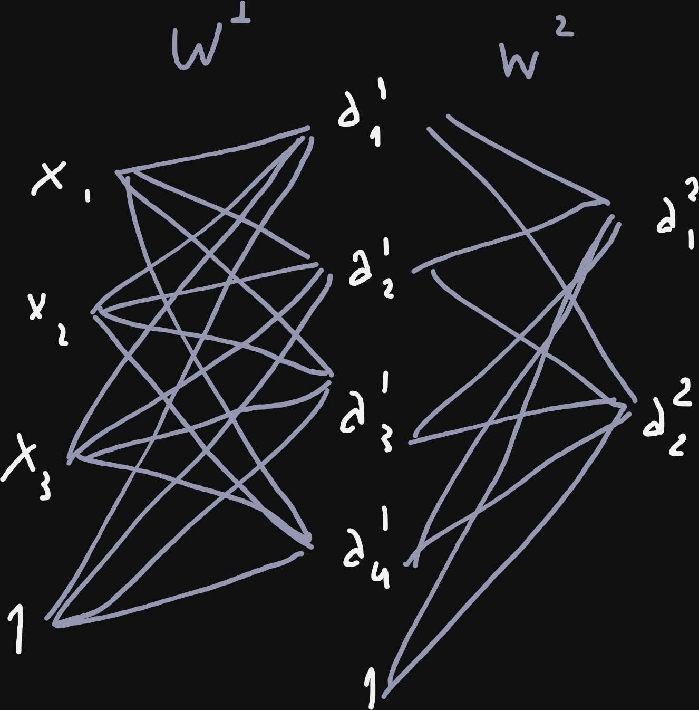

$W^1: 4 \times 4, W^2: 5 \times 2$ (bias incluido). Total$=26$

### b

- Pesos de entrada a primera capa oculta: $I \times N_1 + N_1$
- Pesos de capa oculta a capa oculta: $N_i \times N_{i+1} + N_{i+1}$
- Pesos última capa oculta a salida: $N_M \times O + O$

Total: $I \times N_1 + N_1 + N_M \times O + O + \sum_{i=2}^{M-1}(N_i \times N_{i+1} + N_{i+1})$

### c

Reemplazando en la formula anterior por N_h:

$O(N_h*M) = O(M)$

## Ejercicio 5

### a

Fórmulas de la redVersión explícita con biases:  

$Z^{[1]} = X W^{[1]} + \mathbf{1} (b^{[1]})^T, \quad A^{[1]} = g_i(Z^{[1]})$

$Z^{[2]} = A^{[1]} W^{[2]} + \mathbf{1} (b^{[2]})^T, \quad A^{[2]} = g_i(Z^{[2]})$   

$Z^{[3]} = A^{[2]} W^{[3]} + \mathbf{1} (b^{[3]})^T, \quad Y = g_o(Z^{[3]})$   

Versión compacta con matrices extendidas:   

$A^{[1]} = g_i(X' W^{[1]'})$   

$A^{[2]} = g_i(A^{[1]'} W^{[2]'})$

$Y = g_o(A^{[2]'} W^{[3]'})$

### b

* $X \in \mathbb{R}^{5 \times 3} \implies n = 5$ instancias, $p_0 = 3$ características de entrada.

* Para que $X W^{[1]}$ sea multiplicable: **$W^{[1]} \in \mathbb{R}^{3 \times 2}$**.
* Salida de capa 1: **$A^{[1]} \in \mathbb{R}^{5 \times 2}$**.
* Para multiplicar $A^{[1]} W^{[2]}$: **$W^{[2]} \in \mathbb{R}^{2 \times 1}$**.
* Salida de capa 2: **$A^{[2]} \in \mathbb{R}^{5 \times 1}$**.
* Para multiplicar $A^{[2]} W^{[3]}$: **$W^{[3]} \in \mathbb{R}^{1 \times 2}$**.
* Salida final de la red: **$Y \in \mathbb{R}^{5 \times 2}$**.

## Ejercicio 6

### a

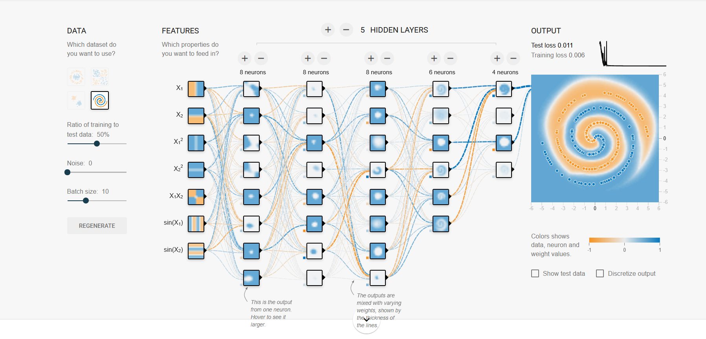

## Ejercicio 7

### a

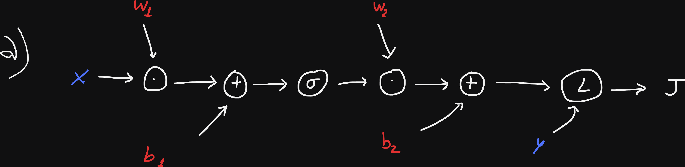

### b

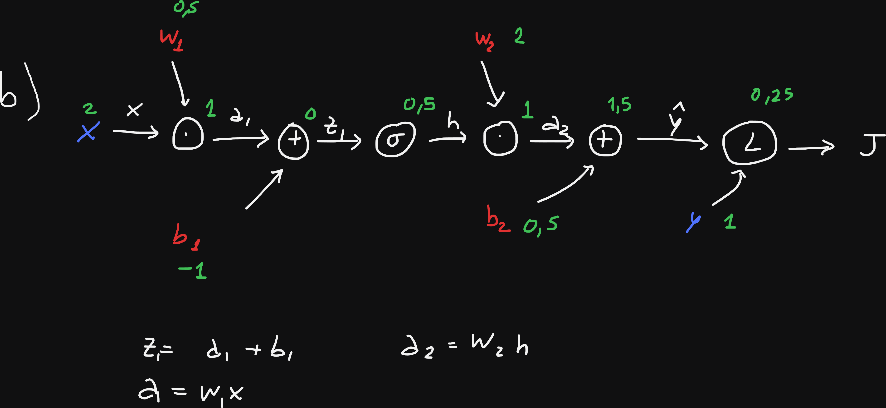

### c

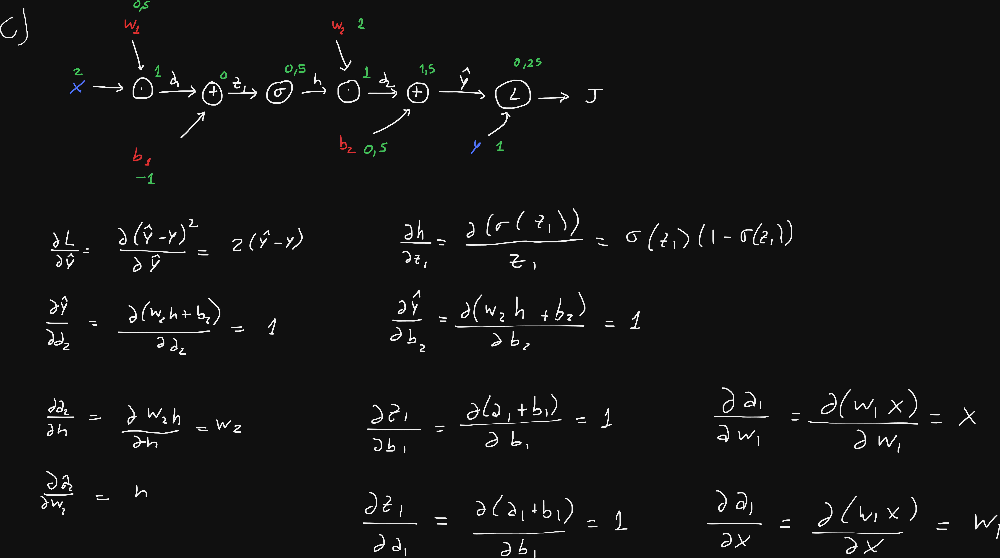

### d

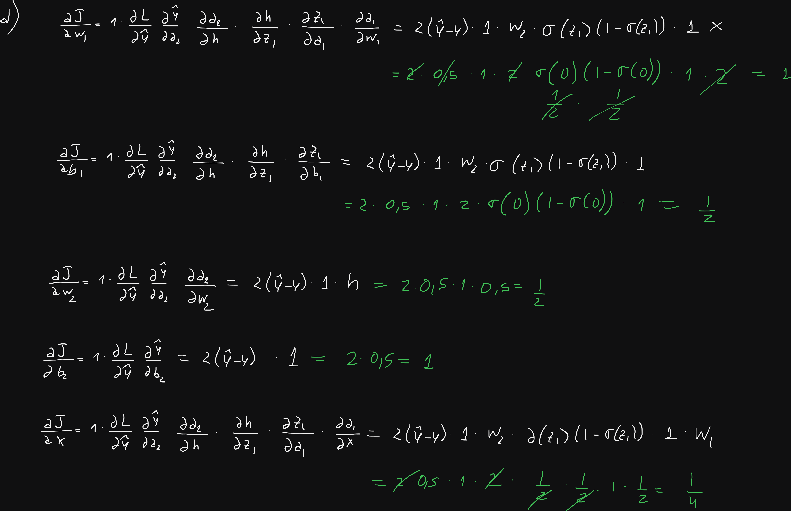

### e

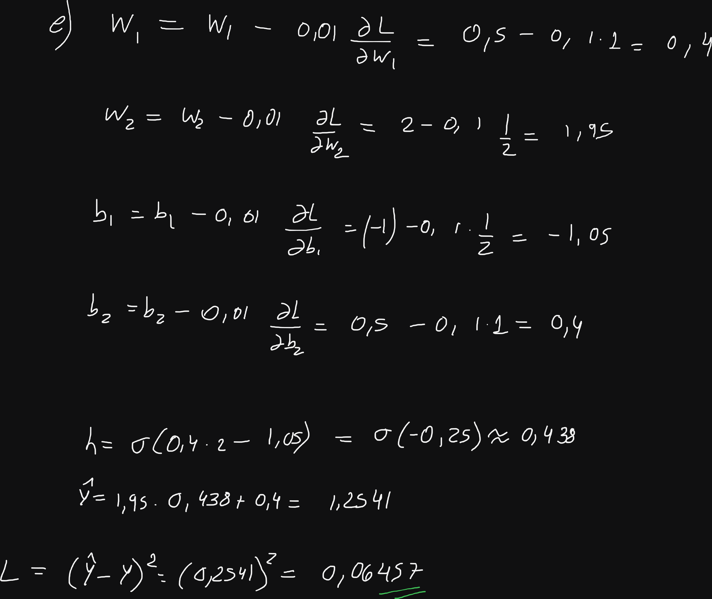

### f

El nodo que representa una instancia x, ahora sería un vector (o matriz si tinee más de un atributo). El nodo de etiqueta y ahora sería un vector, y las operaciones se cambian por operaciones vectoriales y matriciales.

Las funciones de activaciones se aplican a cada elemento de un vector.

Finalmente se agrega un nodo más que corresponde al promedio del costo de las predicciones de cada instancia. En el calculo del gradiente, cada parámetro recibe gradientes de cada instancia (por la regla de la cadena y derivada de la suma es la suma de derivadas).

### a

Verdadero, la sigmoide transforma la salida en una distribución de probabilidades. Suman 1.

## Ejercicio 8

### a

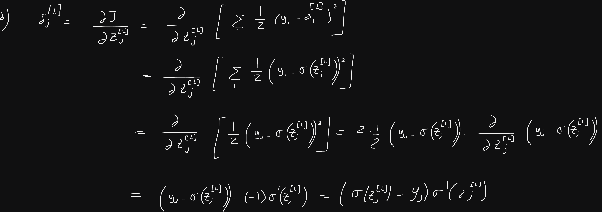

### b

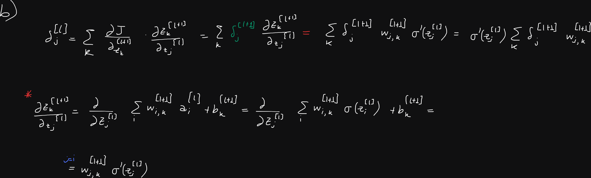

### c

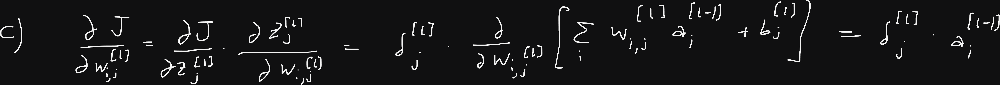

### d

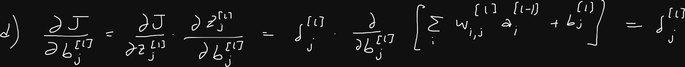

### e

$\delta_j^{l}$ mide la tasa de cambio de la función de pérdida con respecto a el valor de la entrada de la neurona $j$ de la capa $l$.

Si este valor es 0, implica que cambios en los pesos de la entrada y bias de esta neurona no cambiarían el costo. Por lo tanto, en el algoritmo de GD, no se actualizarían sus valores. (neurona saturada o gradiente desvanecido) 