# Guia 13

## Ejercicio 1

### a

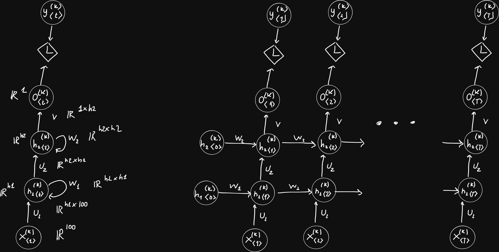

### b

Para la función de activación necesitamos que la salida sea una probabilidad. Un valor entre 0 y 1 donde 1 representa sentimiento positivo y 0 sentimiento negativo. De esta forma también se tiene un grado de certeza en la clasificación. Por lo que la sigmoide parece adecuada.

Para la función de pérdida podemos usar binary cross-entropy que sirve para comaprar distribuciones de probabilidad.

### c

En este caso al ser un problema con una unica salida, solo la salida del tiempo T final se conecta a la función de perdida.

En general, según el problema podríamos tener una entrada a muchas salidas, muchas entradas a una salida, muchos a muchos o muchos a muchos desfasado. Para todas estos problemas se puede agregar la cantidad de entradas y salidas necesarias para que ambas coincidan. Luego fijar en 0 las entradas que no se usen y conectar a la función de perdida las salidas requeridas.

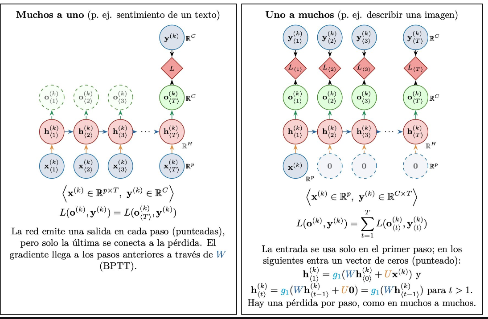

Como las salidas intermedias $o_{\langle 1\rangle}, \dots, o_{\langle T-1\rangle}$ no se conectan a la función de pérdida (o se asume que su gradiente/ponderación de pérdida es cero). El gradiente del error en $T$ fluye hacia atrás a través de las conexiones recurrentes de los estados ocultos mediante Backpropagation Through Time (BPTT) sin necesidad de modificar el optimizador

## Ejercicio 2

### a

Uno a muchos. La entrada es una representación de la imagen en un vector / embedding y la salida es una secuencia temporal de palabras. 

### b

Muchos a uno. La entrada es una secuencia temporal de palabras y la salida es un output entre 0 y 1.

### c

Muchos a muchos desfasado. Secuencia temporal de palabras a otra secuencia temporal de palabras, no necesariamente de la misma longitud.

### d

Muchos a muchos desfasado. Secuencia temporal de ventas del ultimo año de entrada (365 dias). La salida es otra secuencia temporal con la serie de ventas diaria (longitud fija de 30 dias).

### e

Uno a muchos. La entrada es la categoría única y la salida una secuencia de sugerencias.

### f

Muchos a muchos desfasada. La corrección podría eliminar o insertar palabras.

### g

Muchos a Muchos. Por cada paso temporal de la entrada se tiene varias neuronas de salida con función de activación softmax, o sigmoide por clase si puede haber solapamiento.

### h (gemini)

Muchos a muchos desfasado. Es una tarea de síntesis de voz donde se mapea una secuencia de texto (caracteres o fonemas) a una secuencia de señales de audio (espectrogramas/muestras acústicas), donde la tasa de muestreo y duración difieren sustancialmente.

## Ejercicio 3

### a

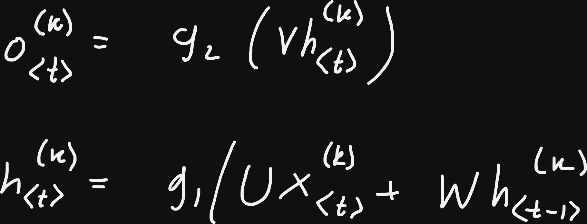

### b

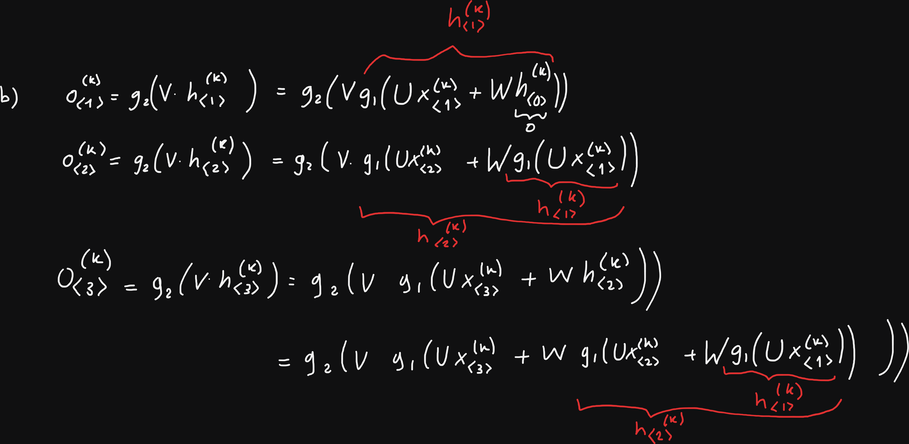

### c

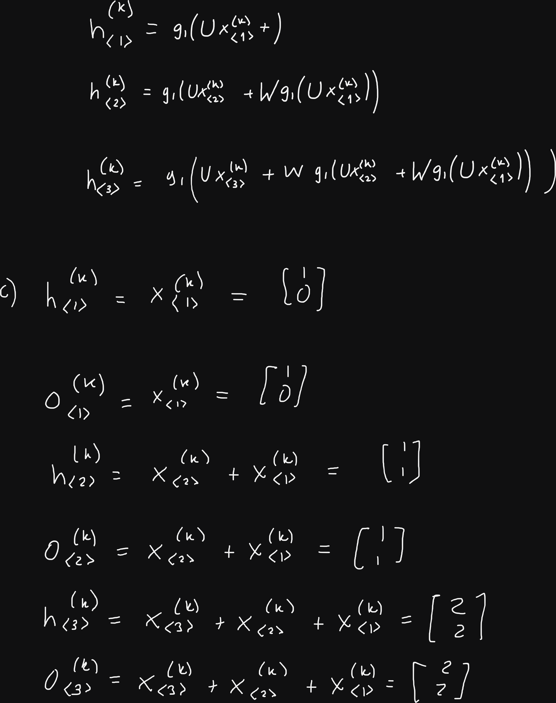

### d

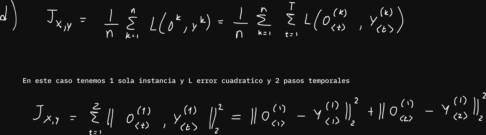

### e

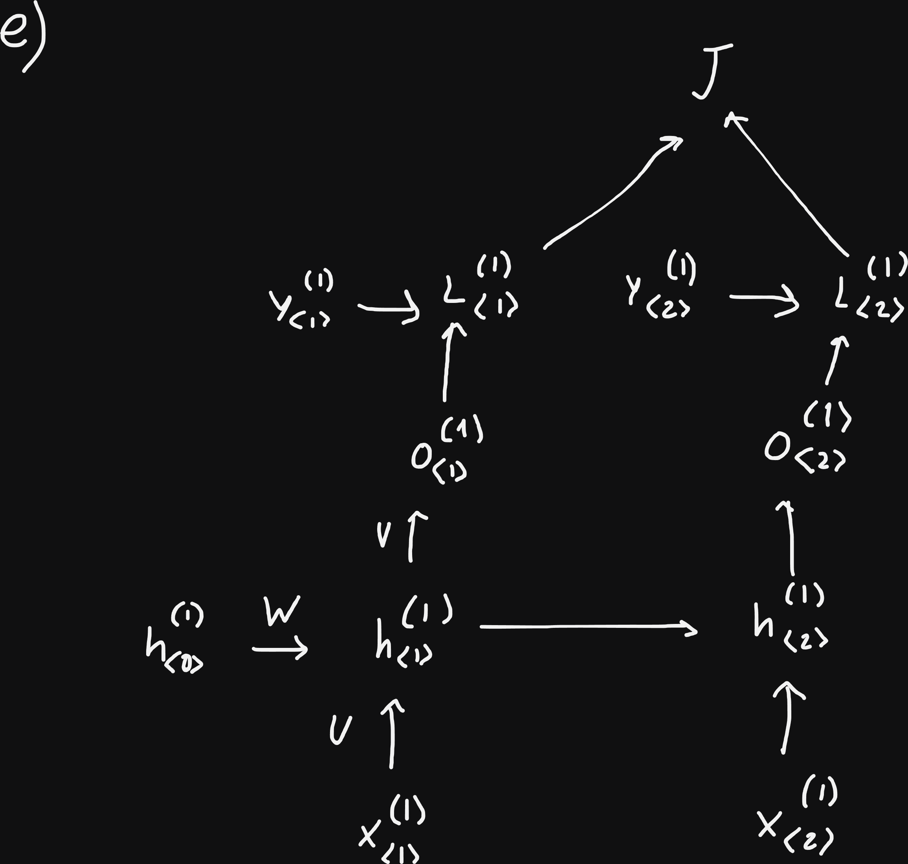

## Ejercicio 4

### a

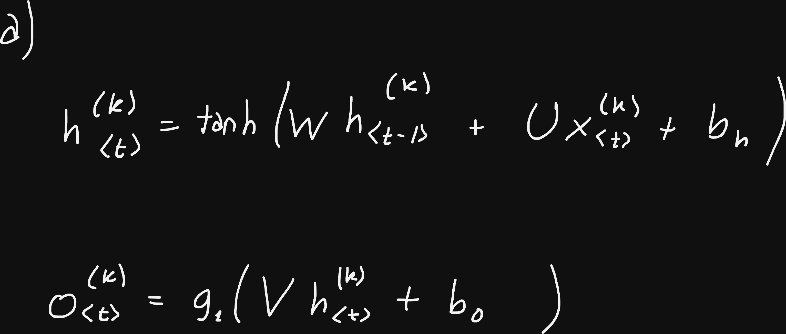

### b

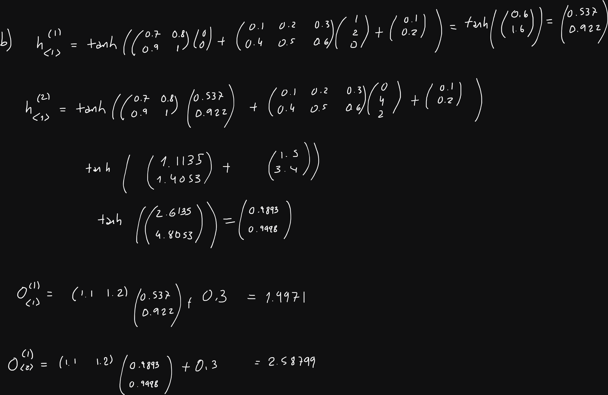

### c

```python

import numpy as np

x = [np.array([1, 2, 0]), np.array([0, 4, 2])]
h = np.array([0.0, 0.0])
U = np.array([[0.1, 0.2, 0.3], [0.4, 0.5, 0.6]])
W = np.array([[0.7, 0.8], [0.9, 1.0]])
V = np.array([[1.1, 1.2]])
b_h = np.array([0.1, 0.2])
b_o = np.array([0.3])

for t, x_t in enumerate(x, start=1):
  z = W @ h + U @ x_t + b_h
  h = np.tanh(z)
  o = V @ h + b_o
  print(f"Paso t={t}:")
  print(f"  h_<{t}> = {np.round(h, 5)}")
  print(f"  o_<{t}> = {np.round(o[0], 5)}")


"""
Paso t=1:
  h_<1> = [0.53705 0.92167]
  o_<1> = 1.99676
Paso t=2:
  h_<2> = [0.98931 0.99987]
  o_<2> = 2.58808
"""
```

## Ejercicio 5

### a

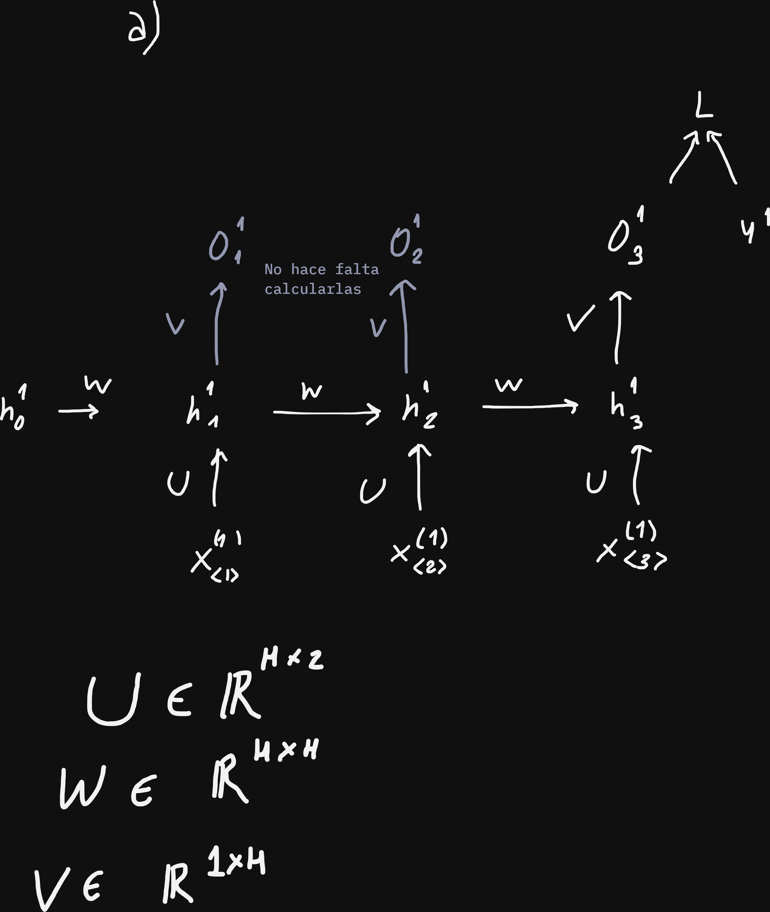

### b


### c

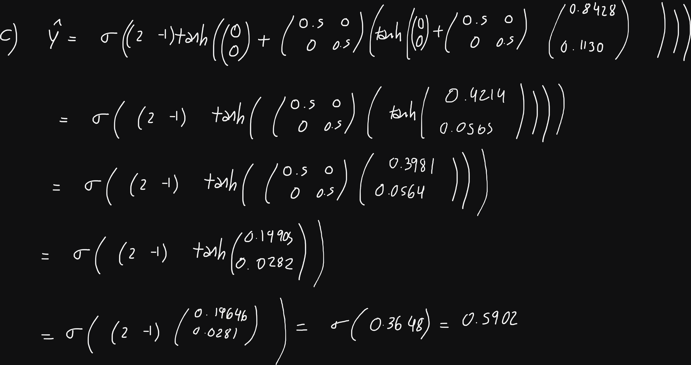

### d

Se da un "camino" a cada nodo $h_t$ para que el gradiente viaje directamente sin tener que pasar por toda la cadena. Así las primeras no sufren el gradient vanish.

#### Gemini

### 1. ¿Cómo cambia la arquitectura y la pérdida?

En el planteo original de muchos a uno, la predicción se realiza exclusivamente con el estado final:


$$\hat{y} = \sigma(V h_{\langle T\rangle}) \quad \text{[cite: 55]}$$

En el ejercicio 13.5d, se reemplaza $h_{\langle T\rangle}$ por el **promedio temporal de todos los estados ocultos** $\bar{h}$:


$$\bar{h} = \frac{1}{T} \sum_{t=1}^{T} h_{\langle t\rangle} \quad \text{[cite: 56]}$$

$$\hat{y} = \sigma(V \bar{h}) \quad \text{[cite: 55, 56]}$$

$$J = L(\hat{y}, y) \quad \text{[cite: 55, 56]}$$

---

### 2. ¿Cómo cambia el cálculo del gradiente del costo?

#### Para la matriz de salida $V$

* **Antes:** $\frac{\partial J}{\partial V} = \frac{\partial J}{\partial \hat{y}} \sigma'(V h_{\langle T\rangle}) h_{\langle T\rangle}^\top$.


* **Ahora:** Como la salida se proyecta a partir de $\bar{h}$:


$$\frac{\partial J}{\partial V} = \frac{\partial J}{\partial \hat{y}} \sigma'(V \bar{h}) \bar{h}^\top = \delta_{\text{salida}} \cdot \bar{h}^\top \quad \text{[cite: 55, 56]}$$


---

#### Para los estados ocultos $h_{\langle t\rangle}$

En el caso original, solo el último estado $h_{\langle T\rangle}$ recibía gradiente directo de la pérdida ($L$ solo dependía de $h_{\langle T\rangle}$). Para los pasos anteriores ($t < T$), el gradiente debía viajar forzosamente por la cadena recurrente hacia el pasado.

Ahora, cada estado oculto individual $h_{\langle t\rangle}$ interviene en $J$ a través de **dos caminos distintos**:

1. **Camino directo (a través de $\bar{h}$):**

$$\frac{\partial J}{\partial \bar{h}} = V^\top \delta_{\text{salida}} \implies \frac{\partial J}{\partial h_{\langle t\rangle}}\Bigg\vert{}_{\text{directo}} = \frac{\partial J}{\partial \bar{h}} \frac{\partial \bar{h}}{\partial h_{\langle t\rangle}} = \frac{1}{T} \frac{\partial J}{\partial \bar{h}}$$


2. **Camino recurrente (a través del estado siguiente $h_{\langle t+1\rangle}$):**

$$\frac{\partial J}{\partial h_{\langle t\rangle}}\Bigg\vert{}_{\text{recurrente}} = \frac{\partial J}{\partial h_{\langle t+1\rangle}} \frac{\partial h_{\langle t+1\rangle}}{\partial h_{\langle t\rangle}}$$


Por la regla de la cadena multivariable, el gradiente total acumulado respecto a cualquier estado intermedio $h_{\langle t\rangle}$ es:


$$\frac{\partial J}{\partial h_{\langle t\rangle}} = \underbrace{\frac{1}{T} \frac{\partial J}{\partial \bar{h}}}_{\text{inyección directa sin importar el tiempo } t} + \underbrace{\frac{\partial J}{\partial h_{\langle t+1\rangle}} \operatorname{diag}\big(1 - h_{\langle t+1\rangle}^2\big) W}_{\text{propagación recurrente hacia atrás}} \quad \text{[cite: 5, 56]}$$

---

#### Para la matriz de pesos recurrente $W$

El gradiente respecto a $W$ sigue sumando los aportes de cada paso:


$$\frac{\partial J}{\partial W} = \sum_{t=1}^{T} \frac{\partial J}{\partial z_{\langle t\rangle}} h_{\langle t-1\rangle}^\top \quad \text{[cite: 5, 21]}$$


donde $\frac{\partial J}{\partial z_{\langle t\rangle}} = \operatorname{diag}\big(1 - h_{\langle t\rangle}^2\big) \frac{\partial J}{\partial h_{\langle t\rangle}}$.

La diferencia clave está en el primer paso ($t=1$):

* **Antes:** $\frac{\partial J}{\partial h_{\langle 1\rangle}} = \frac{\partial J}{\partial h_{\langle T\rangle}} \prod_{k=2}^{T} \operatorname{diag}\big(1 - h_{\langle k\rangle}^2\big) W \approx \vec{0}$ (desvanecido por $T-1$ multiplicaciones).


* **Ahora:**

$$\frac{\partial J}{\partial h_{\langle 1\rangle}} = \frac{1}{T} \frac{\partial J}{\partial \bar{h}} + \text{(términos recurrentes atenuados)}$$


---

### 3. Ventajas y justificación ("¿Por qué?")

* **Mitiga el *vanishing gradient* para las primeras palabras:** El término directo $\frac{1}{T} \frac{\partial J}{\partial \bar{h}}$ no depende de la distancia temporal ni pasa por ninguna multiplicación sucesiva por $W$ o por derivadas de la $\tanh$. El gradiente del error llega de forma directa e intacta a $h_{\langle 1\rangle}$, garantizando que la red pueda ajustar $W$ y $U$ para aprender de las palabras del inicio del texto.


* **Actúa como una "autopista de gradiente" (similar a una conexión residual):** En lugar de forzar a que toda la señal de error viaje secuencialmente a través de $T$ pasos hacia atrás, el promedio distribuye el gradiente en paralelo sobre todos los instantes temporales en un solo salto.


* **Mayor robustez en reseñas largas:** El modelo deja de depender exclusivamente de que el vector $h_{\langle T\rangle}$ tenga que retener y comprimir toda la información de la frase sin olvidar el pasado, permitiendo que palabras clave ubicadas al principio (como un "no" o "nunca") tengan un impacto directo y no disipado en la clasificación.

### e

Se cambia la salida (output):

- Enfoque de Clasificación Multiclase: $C = 5$ neuronas en la capa de salida con función de activación Softmax y pérdida de Entropía Cruzada Categórica.   
- Enfoque de Regresión: $C = 1$ neurona con activación lineal (o sigmoidea reescalada al intervalo $[1, 5]$) optimizada con Error Cuadrático Medio (MSE).

## Ejercicio 6

### a

$$h_{\langle t\rangle}^{(k)} = g_1\big(W_1 h_{\langle t-1\rangle}^{(k)} + W_4 o_{\langle t-1\rangle}^{(k)} + W_3 x_{\langle t\rangle}^{(k)}\big)$$

$$o_{\langle t\rangle}^{(k)} = g_2(W_2 h_{\langle t\rangle}^{(k)})$$

### b

Frente a realimentar solo la salida ($W_1 = 0$):
- Ventajas: El estado oculto $h$ es un espacio latente de alta dimensionalidad no restringido por las clases de salida. Permite retener representaciones complejas y dinámicas internas ricas que un vector de salida colapsado no puede encapsular. 
(Se restringe la "memoria" al espacio de salida que en general es reducido).

Frente a realimentar solo el estado oculto ($W_4 = 0$):
- Ventajas: Le brinda al modelo conocimiento directo y explícito del token o decisión previamente discretizada/emitida.  
- Desventajas: Introduce mayor cantidad de parámetros, expone al modelo a exposure bias si predice incorrectamente en tiempo de inferencia, y dificulta la paralelización del cómputo recurrente. 
(A coste de más paramétros, pones a disposición del aprendizaje del tiempo t+1 la decisión tomada del tiempo t)


---
## Ejercicio 10 y 11 GEMINI
---
### Conceptos Fundamentales: Arquitecturas Encoder-Decoder y Mecanismos de Atención

---

#### 1. ¿Por qué surge el esquema Encoder-Decoder (Seq2Seq)?

En problemas como traducción automática o generación de resúmenes, nos enfrentamos a tareas de secuencia a secuencia (muchos a muchos desfasado) donde la longitud de la entrada (por ejemplo, una frase en español de 5 palabras) no coincide con la longitud de la salida (su traducción en inglés de 4 palabras).

Una RNN estándar sincronizada (donde en cada paso temporal se lee una entrada y se emite inmediatamente una salida) no sirve porque requiere saber toda la idea antes de empezar a responder y que las secuencias tengan longitudes alineadas paso a paso.

Por eso se divide el problema en dos redes neuronales conectadas en serie:

1. **El Codificador (Encoder):**
* Es una red recurrente (usualmente Bidireccional para procesar pasado y futuro del texto fuente) que recibe la secuencia de entrada paso a paso: $x_{\langle 1\rangle}, x_{\langle 2\rangle}, \dots, x_{\langle E\rangle}$.


* En cada paso calcula un vector de estado oculto:

$$h_{\langle i\rangle} = \phi(h_{\langle i-1\rangle}, x_{\langle i\rangle}) \quad \text{[cite: 32]}$$


* Al terminar de leer la entrada, el último estado $h_{\langle E\rangle}$ resume conceptualmente toda la oración y define un **vector de contexto fijo** $c = h_{\langle E\rangle}$.


2. **El Decodificador (Decoder):**
* Es una red recurrente **unidireccional** (no puede ser bidireccional porque en la práctica genera el texto token a token de izquierda a derecha de forma causal).


* Se inicializa tomando como estado oculto inicial el vector de contexto provisto por el codificador: $s_{\langle 0\rangle} = c$.


* En cada paso $t$, actualiza su estado interno $s_{\langle t\rangle}$ y calcula una distribución de probabilidades sobre todo el vocabulario con una función $\text{Softmax}$ para elegir la siguiente palabra:


$$s_{\langle t\rangle} = g(s_{\langle t-1\rangle}, y_{\langle t-1\rangle}, c) \quad \text{[cite: 32]}$$


$$p(o_{\langle t\rangle} \mid \dots) = \text{Softmax}(V s_{\langle t\rangle}) \quad \text{[cite: 33, 34]}$$


* **¿Qué entra al decoder en cada paso?**
* En el primer paso $t=1$, siempre entra un token especial de inicio de secuencia: `"<START>"` (o `<SOS>`, *start of sequence*).


* Durante el **entrenamiento**, para estabilizar y acelerar el aprendizaje, se suele utilizar **Teacher Forcing** (se le pasa como entrada el token real objetivo del paso anterior $y_{\langle t-1\rangle}$).


* Durante la **inferencia / predicción** (en producción), como no conocemos las respuestas correctas, se le pasa la palabra predicha por la propia red en el paso anterior ($\hat{y}_{\langle t-1\rangle}$).


* **¿Cuándo termina la generación?** Cuando el decoder predice el token especial de finalización `"<END>"` (o `<EOS>`, *end of sequence*) o cuando se alcanza un umbral máximo preestablecido de pasos.


---

#### 2. El Cuello de Botella (*Bottleneck*) y el Problema de la Memoria

En el esquema tradicional sin atención, **toda la información del texto fuente se condensa forzosamente en un único vector estático** ($c = h_{\langle E\rangle}$) de dimensión fija.

* Si la oración de entrada tiene 50 palabras, intentar resumir toda la sintaxis y semántica en un vector de, por ejemplo, 512 números genera una enorme pérdida de detalles.


* Además, por el desvanecimiento del gradiente en las RNNs, la información de las primeras palabras del texto prácticamente se diluye para cuando se llega al último estado oculto.


---

#### 3. Mecanismo de Atención (Atención Dinámica)

Para solucionar el cuello de botella, los mecanismos de atención (Bahdanau 2014, Luong 2015) proponen **no descartar los estados ocultos intermedios del encoder** ($h_{\langle 1\rangle}, \dots, h_{\langle E\rangle}$). En lugar de un vector $c$ fijo, en cada paso $t$ del decoder se computa un **vector de contexto dinámico $c_{\langle t\rangle}$** que es un promedio ponderado de los estados del encoder según cuánto se relacionan con lo que el decoder quiere generar en ese instante:

El proceso tiene 4 pasos matemáticos concretos:

1. **Cálculo de puntajes o scores de alineación ($e_{\langle t, i\rangle}$):**
Miden cuán compatible o relevante es el estado $h_{\langle i\rangle}$ de la palabra $i$ de entrada con el estado $s$ del decoder en el paso $t$.


* En **Atención de Luong (Dot product / Producto punto)**:


$$e_{\langle t, i\rangle} = s_{\langle t\rangle}^\top h_{\langle i\rangle} \quad \text{[cite: 41, 51]}$$


* En **Atención de Bahdanau (Aditiva)**:


$$e_{\langle t, i\rangle} = v_a^\top \tanh(W_a s_{\langle t-1\rangle} + U_a h_{\langle i\rangle}) \quad \text{[cite: 51]}$$


*(Bahdanau usa $s_{\langle t-1\rangle}$ porque calcula el contexto $c_{\langle t\rangle}$ antes de calcular el estado actual $s_{\langle t\rangle}$ para alimentar a la celda RNN; Luong calcula primero $s_{\langle t\rangle}$ con la RNN y luego busca qué mirar en el encoder)*.


2. **Pesos de alineación / atención ($\alpha_{\langle t, i\rangle}$):**
Se normalizan los scores con una función $\text{Softmax}$ a lo largo de las palabras de entrada para convertirlos en una distribución de probabilidades (números positivos entre 0 y 1 que suman 1):


$$\alpha_{\langle t, i\rangle} = \frac{e^{e_{\langle t, i\rangle}}}{\sum_{k=1}^{E} e^{e_{\langle t, k\rangle}}} \quad \text{[cite: 42, 51]}$$


$\alpha_{\langle t, i\rangle}$ representa la proporción de atención que el decoder le presta a la palabra $i$ en el instante $t$.


3. **Vector de contexto ($c_{\langle t\rangle}$):**
Es la suma ponderada de todos los vectores de estado del codificador multiplicados por sus respectivos pesos de atención:


$$c_{\langle t\rangle} = \sum_{i=1}^{E} \alpha_{\langle t, i\rangle} h_{\langle i\rangle} \quad \text{[cite: 43, 51, 52]}$$


Tiene exactamente la misma dimensión que los vectores $h_{\langle i\rangle}$.


4. **Combinación y proyección a la salida:**
Se concatena el vector de contexto con el estado del decodificador $[c_{\langle t\rangle}; s_{\langle t\rangle}]$, se pasa por una capa densa con $\tanh$ para obtener un estado enriquecido $\tilde{s}_{\langle t\rangle}$, y finalmente se proyecta linealmente con $W_s$ hacia el tamaño del vocabulario de salida $C$ pasando por $\text{Softmax}$:


$$\tilde{s}_{\langle t\rangle} = \tanh\big(W_c [c_{\langle t\rangle}; s_{\langle t\rangle}]\big) \quad \text{[cite: 44, 50]}$$


$$p(o_{\langle t\rangle} \mid \dots) = \text{Softmax}(W_s \tilde{s}_{\langle t\rangle}) \quad \text{[cite: 44, 50]}$$


---

### Explicación y Deducción Paso a Paso del Ejercicio 13.10

**Enunciado:** Diseñar una red encoder-decoder con RNNs que resuma textos. Dibujarla indicando qué entra al decoder en cada paso (durante el entrenamiento y al predecir) y cuándo termina la generación. Luego responder los ítems (a) a (h).

#### Esquema de la red y flujo de señales

```text
TEXTO ORIGINAL: "El presidente anunció nuevas medidas económicas..."
      │               │                │               │
      ▼               ▼                ▼               ▼
   [x_<1>]         [x_<2>]          [x_<3>]         [x_<E>]
      │               │                │               │
   ┌──┴───────────────┴────────────────┴───────────────┴──┐
   │             ENCODER (Bi-LSTM / Bi-GRU)               │
   └──┬───────────────┬────────────────┬───────────────┬──┘
      ▼               ▼                ▼               ▼
   h_<1>           h_<2>            h_<3>           h_<E>
      │               │                │               │
      └───────────────┼────────────────┼───────────────┘
                      ▼                ▼
         ┌────────────────────────────────────────┐
         │     MECANISMO DE ATENCIÓN DINÁMICA     │
         └──────────────────┬─────────────────────┘
                            ▼ c_<t> (vector de contexto)
   ┌────────────────────────┴─────────────────────┐
   │             DECODER (LSTM / GRU)             │
   └────────┬──────────────────────┬──────────────┘
            ▼                      ▼
         o_<1>                  o_<2>           ...    o_<T> (<END>)

```

* **¿Qué entra al Decoder en cada paso?**
* *Entrenamiento:* En el paso $t=1$ entra el token `<START>`. En los pasos siguientes $t > 1$, gracias al uso de **Teacher Forcing**, entra la palabra real del texto objetivo anterior $y_{\langle t-1\rangle}$.


* *Predicción (Inferencia):* En $t=1$ entra `<START>`. En $t > 1$ entra la predicción que generó el propio modelo en el paso anterior $\hat{y}_{\langle t-1\rangle}$.


* **¿Cuándo termina la generación?**
* Cuando el decodificador emite el token especial `<END>` o cuando se alcanza una cantidad máxima permitida de pasos $T_{\max}$.


#### Justificación detallada de cada ítem:

* **(a) ¿Qué tipo de red se usa en el encoder?**
  * **Respuesta:** Una RNN **Bidireccional** (típicamente Bi-LSTM o Bi-GRU).


  * **Justificación:** El texto a resumir ya está completamente disponible desde el inicio. Procesar la secuencia de izquierda a derecha ($\vec{h}$) y de derecha a izquierda ($\overleftarrow{h}$) permite que cada palabra codifique el contexto de toda la oración (tanto lo que vino antes como lo que viene después).


* **(b) ¿Y en el decoder?**
  * **Respuesta:** Una RNN **Unidireccional** (LSTM o GRU).


  * **Justificación:** El decoder genera el texto token por token de manera autorregresiva (causal). No puede ser bidireccional porque en tiempo real de generación las palabras futuras aún no existen.


* **(c) ¿Cómo se conecta el encoder con el decoder?**
  * **Respuesta:** Tradicionalmente se puede inicializar el primer estado oculto del decoder con el último estado del encoder ($s_{\langle 0\rangle} = h_{\langle E\rangle}$), pero en una arquitectura moderna se conectan a través de la **capa de atención**, la cual toma todos los estados $\{h_{\langle 1\rangle}, \dots, h_{\langle E\rangle}\}$ del encoder y provee un vector de contexto dinámico $c_{\langle t\rangle}$ a cada paso del decoder.


* **(d) ¿Se usa algún mecanismo de atención? ¿Por qué ayuda en este problema?**
  * **Respuesta:** Sí, es fundamental.


  * **Justificación:** Un texto largo para resumir contiene cientos de palabras. Sin atención, el encoder sufriría del cuello de botella al tener que comprimir todo en un solo vector fijo. La atención permite al decoder "hacer foco" dinámicamente en los párrafos o palabras clave del texto fuente relevantes para la frase que está escribiendo en cada momento.


* **(e) ¿Las redes usadas leen la entrada de manera secuencial?**
  * **Respuesta:** Sí.


  * **Justificación:** Por definición matemática, en una RNN el cálculo del estado $h_{\langle t\rangle}$ depende estrictamente del estado anterior $h_{\langle t-1\rangle}$, obligando a procesar token tras token de manera temporalmente secuencial.


* **(f) ¿Se podrían usar redes que lean la entrada de manera bidireccional? ¿En el encoder, en el decoder o en ambos?**
  * **Respuesta:** Solo en el encoder.


  * **Justificación:** En el encoder toda la secuencia de entrada está disponible desde el principio, por lo que se puede leer en ambas direcciones sin violar la causalidad. En el decoder no es viable porque en inferencia la red predice palabra por palabra hacia adelante; no tiene acceso al futuro que aún no ha generado.


* **(g) ¿Existen redes que lean toda la entrada al mismo tiempo?**
  * **Respuesta:** Sí, los **Transformers** (como BERT o GPT).


  * **Justificación:** Reemplazan la recurrencia paso a paso por mecanismos de autoatención (*self-attention*) aplicados en paralelo sobre toda la secuencia con codificación posicional (*positional encoding*), procesando todos los tokens simultáneamente.


* **(h) ¿Hay algún límite en el tamaño de la entrada?**
  * **Respuesta:** Sí.


  * **Justificación:** En RNNs, secuencias extremadamente largas provocan problemas de desvanecimiento del gradiente e imposibilidad de paralelizar BPTT en memoria. Incluso con atención o Transformers, la matriz de atención compara cada token con todos los demás, escalando cuadráticamente ($\mathcal{O}(E^2)$ en cómputo y memoria), lo que fija un límite físico máximo de contexto disponible.


---

### Explicación y Deducción Paso a Paso del Ejercicio 13.11

Datos provistos:

* Estados del encoder: $h_{\langle 1\rangle} = \begin{pmatrix} 2 \\ 0 \end{pmatrix}$, $h_{\langle 2\rangle} = \begin{pmatrix} 0 \\ 2 \end{pmatrix}$, $h_{\langle 3\rangle} = \begin{pmatrix} 1 \\ 1 \end{pmatrix}$.


* Estado actual del decoder: $s_{\langle t\rangle} = \begin{pmatrix} 1 \\ 0 \end{pmatrix}$.


* Constantes útiles: $e \approx 2.718$, $e^2 \approx 7.389$.


---

#### (a) Calcular los scores $e_{\langle t, i\rangle} = s_{\langle t\rangle}^\top h_{\langle i\rangle}$

* **Concepto:** En la atención de Luong, la similitud es simplemente el producto punto entre el vector del decoder y cada vector del encoder.


* **Cálculo:**

$$e_{\langle t, 1\rangle} = \begin{pmatrix} 1 & 0 \end{pmatrix} \begin{pmatrix} 2 \\ 0 \end{pmatrix} = 1 \cdot 2 + 0 \cdot 0 = \mathbf{2} \quad \text{[cite: 41, 57]}$$


$$e_{\langle t, 2\rangle} = \begin{pmatrix} 1 & 0 \end{pmatrix} \begin{pmatrix} 0 \\ 2 \end{pmatrix} = 1 \cdot 0 + 0 \cdot 2 = \mathbf{0} \quad \text{[cite: 41, 57]}$$


$$e_{\langle t, 3\rangle} = \begin{pmatrix} 1 & 0 \end{pmatrix} \begin{pmatrix} 1 \\ 1 \end{pmatrix} = 1 \cdot 1 + 0 \cdot 1 = \mathbf{1} \quad \text{[cite: 41, 57]}$$


---

#### (b) Calcular los pesos de atención $\alpha_{\langle t, i\rangle} = \text{Softmax}_i(e_{\langle t, i\rangle})$

* **Concepto:** Convertimos los escalares $[2, 0, 1]$ en probabilidades mediante la exponencial dividida por la suma de exponenciales.


* **Cálculo:**
* $e^{e_1} = e^2 \approx 7.389$


* $e^{e_2} = e^0 = 1$
* $e^{e_3} = e^1 \approx 2.718$


* Denominador (suma total): $\sum_i e^{e_i} = 7.389 + 1 + 2.718 = 11.107$


* **Pesos resultantes:**

$$\alpha_{\langle t, 1\rangle} = \frac{7.389}{11.107} \approx \mathbf{0.665} \quad (66.5\%)$$


$$\alpha_{\langle t, 2\rangle} = \frac{1}{11.107} \approx \mathbf{0.090} \quad (9.0\%)$$


$$\alpha_{\langle t, 3\rangle} = \frac{2.718}{11.107} \approx \mathbf{0.245} \quad (24.5\%)$$


* **¿Cuánto suman?** $0.665 + 0.090 + 0.245 = \mathbf{1.0}$ (como toda distribución $\text{Softmax}$).


* **¿A qué palabra presta más atención?** A la **primera palabra** ($h_{\langle 1\rangle}$), que concentra el $66.5\%$ del peso de atención.

---

#### (c) Calcular el vector de contexto $c_{\langle t\rangle} = \sum_i \alpha_{\langle t, i\rangle} h_{\langle i\rangle}$

* **Concepto:** Realizamos la combinación lineal de los vectores del encoder ponderados por los pesos $\alpha$.


* **Cálculo:**

$$c_{\langle t\rangle} = 0.665 \begin{pmatrix} 2 \\ 0 \end{pmatrix} + 0.090 \begin{pmatrix} 0 \\ 2 \end{pmatrix} + 0.245 \begin{pmatrix} 1 \\ 1 \end{pmatrix} \quad \text{[cite: 43, 57]}$$


$$c_{\langle t\rangle} = \begin{pmatrix} 1.330 \\ 0 \end{pmatrix} + \begin{pmatrix} 0 \\ 0.180 \end{pmatrix} + \begin{pmatrix} 0.245 \\ 0.245 \end{pmatrix} = \begin{pmatrix} 1.330 + 0.245 \\ 0.180 + 0.245 \end{pmatrix} = \begin{pmatrix} \mathbf{1.575} \\ \mathbf{0.425} \end{pmatrix}$$


* **Dimensión:** Pertenece a $\mathbb{R}^2$. La dimensión de $c_{\langle t\rangle}$ siempre coincide exactamente con la dimensión de los estados ocultos del codificador ($H = 2$).


---

#### (d) Vector concatenado y dimensiones de $W_c$ y $W_s$

* **Vector concatenado $[c_{\langle t\rangle}; s_{\langle t\rangle}]$:**
Juntamos en una sola columna vertical los elementos de $c_{\langle t\rangle} \in \mathbb{R}^2$ seguidos de los de $s_{\langle t\rangle} \in \mathbb{R}^2$:


$$[c_{\langle t\rangle}; s_{\langle t\rangle}] = \begin{pmatrix} 1.575 \\ 0.425 \\ 1.0 \\ 0.0 \end{pmatrix} \in \mathbb{R}^4 \quad \text{[cite: 44, 50, 57]}$$


* **Dimensión de $W_c$:**
La fórmula es $\tilde{s}_{\langle t\rangle} = \tanh(W_c [c_{\langle t\rangle}; s_{\langle t\rangle}])$.
Dado que la salida es $\tilde{s}_{\langle t\rangle} \in \mathbb{R}^2$ y la entrada tiene dimensión $4$, la matriz debe transformar de dimensión 4 a 2:


$$W_c \in \mathbb{R}^{2 \times 4} \quad \text{[cite: 44, 57]}$$


* **Dimensión de $W_s$:**
La fórmula de salida es $p(o_{\langle t\rangle}) = \text{Softmax}(W_s \tilde{s}_{\langle t\rangle})$.
Como el vocabulario final tiene $C$ palabras y la entrada $\tilde{s}$ tiene dimensión $2$, para producir los logits de dimensión $C$ la matriz debe ser:


$$W_s \in \mathbb{R}^{C \times 2} \quad \text{[cite: 44, 57]}$$


---

#### (e) ¿Qué pasa si $s_{\langle t\rangle}$ fuese ortogonal a todos los $h_{\langle i\rangle}$?

* **Deducción:**
    * Si $s_{\langle t\rangle} \perp h_{\langle i\rangle}$ para todo $i$, por definición matemática de ortogonalidad el producto escalar es cero: $e_{\langle t, i\rangle} = s_{\langle t\rangle}^\top h_{\langle i\rangle} = 0 \quad \forall i$.
    * Al aplicar $\text{Softmax}$ sobre valores idénticos ($e^0 = 1$ para todos):

$$\alpha_{\langle t, 1\rangle} = \alpha_{\langle t, 2\rangle} = \alpha_{\langle t, 3\rangle} = \frac{1}{3} \approx \mathbf{0.333} \quad \text{[cite: 42, 51]}$$


Los pesos forman una **distribución uniforme** (el modelo no sabe a qué palabra prestarle más atención y mira a todas por igual).
* El vector de contexto resultante es el promedio aritmético directo de los estados:

$$c_{\langle t\rangle} = \frac{1}{3} \begin{pmatrix} 2 \\ 0 \end{pmatrix} + \frac{1}{3} \begin{pmatrix} 0 \\ 2 \end{pmatrix} + \frac{1}{3} \begin{pmatrix} 1 \\ 1 \end{pmatrix} = \frac{1}{3} \begin{pmatrix} 3 \\ 3 \end{pmatrix} = \begin{pmatrix} \mathbf{1} \\ \mathbf{1} \end{pmatrix} \quad \text{[cite: 43, 57]}$$


---

#### (f) ¿Qué pasa si los scores se multiplican por 10? ¿Y si se dividen por 10?

* **Si se multiplican por 10 ($e_i \times 10$):**
  * Los scores se distancian enormemente: pasan a ser $[20, 0, 10]$.
  * Al calcular exponenciales, $e^{20} \approx 4.85 \times 10^8$, que supera por varios órdenes de magnitud a $e^{10} \approx 22026$ y $e^0 = 1$.
  * La función $\text{Softmax}$ se satura hacia un comportamiento de *Argmax* ("hard attention"):

  $$\alpha_1 \approx 1.0, \quad \alpha_2 \approx 0.0, \quad \alpha_3 \approx 0.0$$


  * La red se vuelve hiper-selectiva y atiende de manera exclusiva al máximo puntaje.


* **Si se dividen por 10 ($e_i / 10$):**
  * Los scores se vuelven muy pequeños y cercanos entre sí: $[0.2, 0.0, 0.1]$.
  * Las exponenciales son casi iguales ($e^{0.2} \approx 1.22$, $e^0 = 1.0$, $e^{0.1} \approx 1.105$).
  * La distribución $\text{Softmax}$ se aplana tendiendo a ser **uniforme** ($\alpha_i \approx \frac{1}{3}$), perdiendo capacidad discriminatoria. *(Esta es la razón por la cual los Transformers dividen el producto punto por $\sqrt{d_k}$: para evitar que los scores crezcan demasiado y saturen los gradientes de la Softmax).*


---

#### (g) Cuello de botella sin atención y cómo lo resuelve la atención

* **El problema del cuello de botella:** Sin atención, el encoder debe comprimir toda la oración en un único vector final $c = h_{\langle 3\rangle}$. Para oraciones largas, ese vector estático no tiene la capacidad de retener todos los detalles sintácticos y las relaciones de las primeras palabras debido a la acumulación de transformaciones y al desvanecimiento del gradiente.


* **Cómo lo resuelve la atención:** Permite que el decoder mantenga una conexión directa con **todos** los estados intermedios del codificador ($h_{\langle 1\rangle}, h_{\langle 2\rangle}, h_{\langle 3\rangle}$). En lugar de consultar una memoria comprimida única, consulta dinámicamente toda la secuencia y construye en cada paso un vector de contexto a medida de lo que necesita traducir en ese instante específico.


---

#### (h) ¿Por qué Bahdanau usa $s_{\langle t-1\rangle}$ en lugar de $s_{\langle t\rangle}$?

* **Justificación arquitectónica:**
  * En la arquitectura de **Bahdanau**, el vector de contexto $c_{\langle t\rangle}$ se calcula **antes** de actualizar el estado oculto del decoder. Por lo tanto, el estado $s_{\langle t\rangle}$ aún no fue calculado, y la red recurrente del decodificador toma el contexto directamente como entrada para computarlo:


$$s_{\langle t\rangle} = f(s_{\langle t-1\rangle}, y_{\langle t-1\rangle}, c_{\langle t\rangle}) \quad \text{[cite: 32]}$$


Dado que $s_{\langle t\rangle}$ no existe todavía al momento de evaluar la atención, necesariamente debe usar el estado disponible previo: $s_{\langle t-1\rangle}$.


* En la arquitectura de **Luong**, primero se calcula la transición recurrente usual del decodificador sin contexto: $s_{\langle t\rangle} = \text{RNN}(s_{\langle t-1\rangle}, y_{\langle t-1\rangle})$. Una vez que ya se tiene $s_{\langle t\rangle}$, este nuevo estado se usa para "preguntarle" al encoder qué palabras son relevantes para emitir la salida inmediata.
